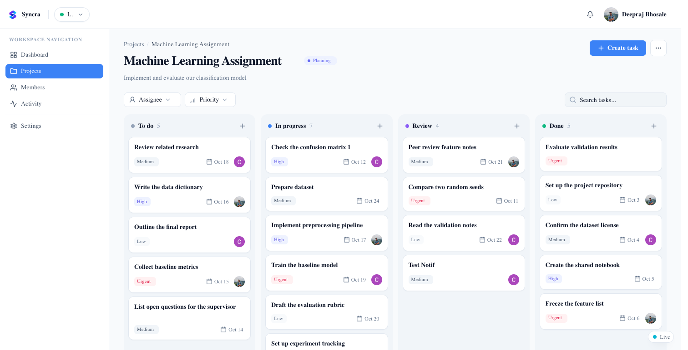
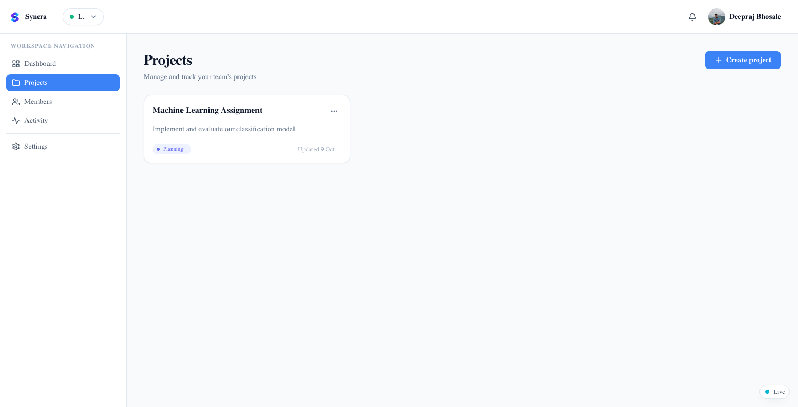
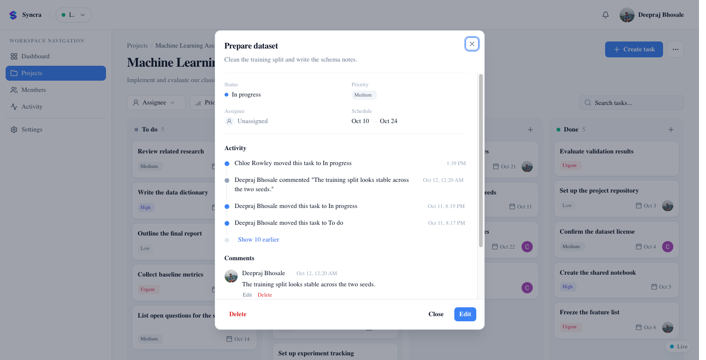
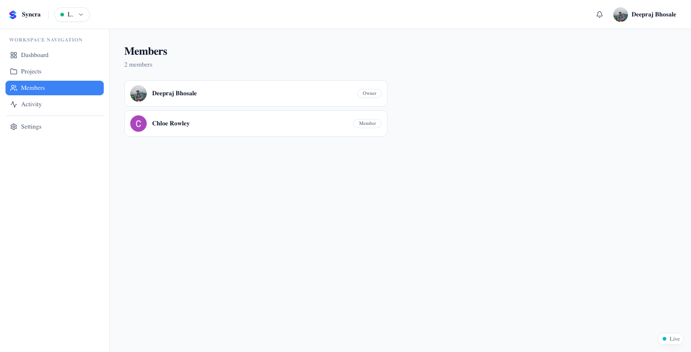
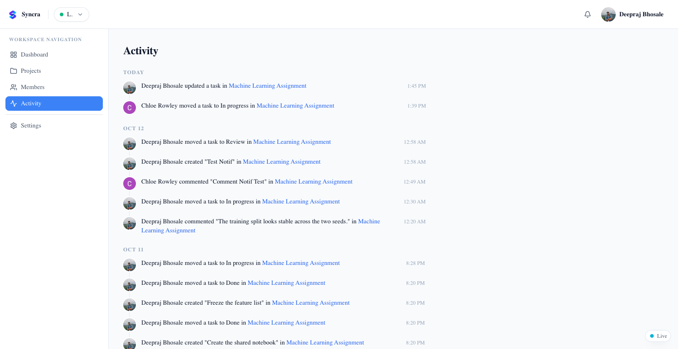
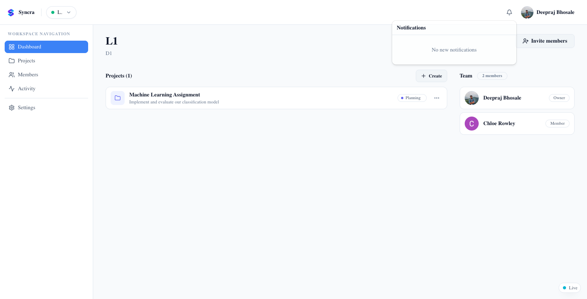
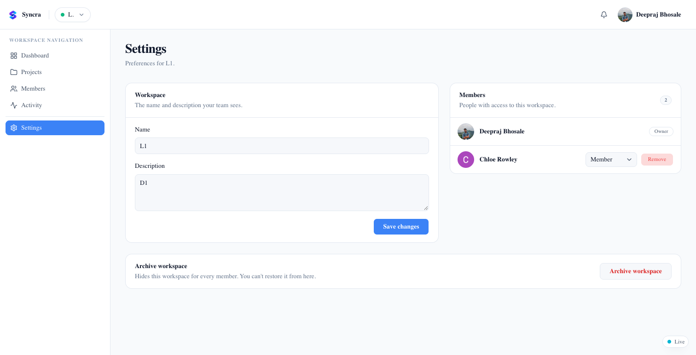
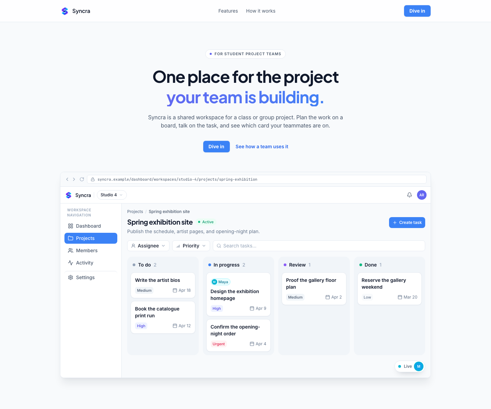

# Syncra Frontend

Syncra is a shared workspace for a student team. Plan a project on a board, talk on the task, and see which card a teammate is on.

The site is live at [syncra-frontend.deeprajb012.workers.dev](https://syncra-frontend.deeprajb012.workers.dev). The pictures of the app below are the signed-in product.

## The board

A project is four columns: To do, In progress, Review, and Done. Each card has a priority, a due date, and the person it is assigned to. Drag a card into the column that matches where the work actually is. Filter by assignee or priority, or search by title.



## Features

### Workspace

A workspace is the home for one class, group, or project. The dashboard lists its projects and the team. Invite people from here. Owners and admins look after the space. Members do the work. Viewers can follow the board and read the discussion.


### Projects

A workspace can hold more than one project. A project has a name, a short description, and a status such as Planning or Active.



### Task

Open a card for the description, status, priority, assignee, and schedule. The activity on that task sits under the details. Comments stay on the card: the author can edit theirs, and the author, an owner, or an admin can delete one. Viewers can read. The people doing the work can write.



### Members

Everyone in the workspace is listed with a role: owner, admin, member, or viewer.



### Activity

The activity page groups what happened by day: who created a task, moved it, changed it, or left a comment, and which project it belongs to.



### Notifications

The bell is for work that involves you. Syncra notifies you when someone assigns you a task, and when someone else comments on a task you are assigned to or have already talked on. Opening a notification marks it read and takes you to that task. You do not get a notification for something you just did yourself.



### Settings

Owners and admins can rename the workspace, change the description, change a person's role, or remove them. Archiving hides the workspace for every member.



### Who else is here

The Live mark in the corner shows that the workspace is connected and who else is in it. On the board, a small chip with their photo and first name sits on the card they are pointing at, or beside the column if they are in that column but not on a card. Opening a task keeps their chip on that card. The assignee is drawn once, so the same person is not shown as both the owner of the card and a second face.

The chip needs a second person in the workspace, so the signed-in pictures above show the Live mark on its own. The home page uses a sample project to show the chip on a card.



## Stack

Next.js 16 and React 19, with Auth0 for sign-in, TanStack Query for the board, and Tailwind. Production runs on Cloudflare through OpenNext. The API is a separate service. The home page, Features, and How it works are public. The dashboard requires a sign-in.

## Run it locally

```bash
bun install
bun run dev
```

The app is at [http://localhost:3000](http://localhost:3000). Put these in `.env` (do not commit that file):

| Variable              | What it is                                    |
| --------------------- | --------------------------------------------- |
| `APP_BASE_URL`        | This app, for example `http://localhost:3000` |
| `AUTH0_DOMAIN`        | Auth0 tenant domain                           |
| `AUTH0_CLIENT_ID`     | Auth0 application client id                   |
| `AUTH0_CLIENT_SECRET` | Auth0 application client secret               |
| `AUTH0_SECRET`        | Secret used to encrypt the session cookie     |
| `AUTH0_AUDIENCE`      | Auth0 API identifier for the Syncra API       |
| `NEXT_PUBLIC_API_URL` | Syncra API origin, with no trailing slash     |

`NEXT_PUBLIC_API_URL` has to be the API this frontend should call. Sign-in only works when that API and the Auth0 application accept this app’s origin. The live connection uses the same origin, so local development should stay on `http://localhost:3000`.

## Scripts

| Command             | What it does                   |
| ------------------- | ------------------------------ |
| `bun run dev`       | Start the local app            |
| `bun run typecheck` | Typecheck with `tsc`           |
| `bun run format`    | Format with Prettier           |
| `bun run build`     | Build for Cloudflare           |
| `bun run deploy`    | Build and deploy with Wrangler |
